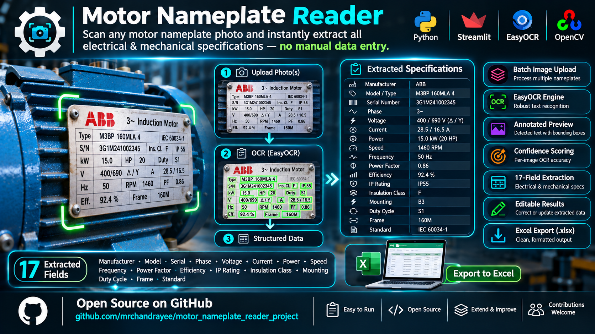

<div align="center">


# ⚙️ Motor Nameplate Reader

**Scan any motor nameplate photo and instantly extract all electrical & mechanical specifications — no manual data entry, no guesswork.**

[Demo](#-workflow) · [Quick Start](#-installation) · [Contributing](#-contributing) · [Roadmap](#-roadmap)

</div>

---

## 📌 Overview

**Motor Nameplate Reader** is an open-source Streamlit application that uses **EasyOCR** and **OpenCV** to automatically read industrial motor nameplates from photos and extract structured specifications — manufacturer, voltage, current, power, speed, efficiency class, IP rating, and more.

Upload a photo, click **Scan**, and export a clean Excel sheet ready for your maintenance system, asset register, or procurement team.

> ⚠️ Always verify electrical ratings against the physical nameplate before maintenance, wiring, or equipment selection. OCR accuracy depends on image quality and plate condition.

---

## 🖥️ Dashboard Preview



---

## ✨ Features

| Feature | Details |
|---|---|
| 📷 **Batch image upload** | Process multiple JPG / PNG photos in one click |
| 🔍 **EasyOCR engine** | Robust text recognition tuned for stamped & printed plates |
| 🖼️ **Annotated preview** | Bounding boxes drawn on detected text regions |
| 📊 **Confidence scoring** | Per-image average OCR confidence displayed |
| 🧩 **17-field structured extraction** | See full field list below |
| ✏️ **Editable results table** | Correct any misread field directly in the UI |
| 📥 **Excel export** | One-click `.xlsx` with formatted data + raw OCR tab |
| 💻 **CPU & GPU support** | CPU works out-of-the-box; GPU via PyTorch/CUDA |

### Extracted Fields

`Manufacturer` · `Model` · `Serial` · `Phase` · `Voltage` · `Current` · `Power` · `Speed` · `Frequency` · `Power Factor` · `Efficiency` · `IP Rating` · `Insulation Class` · `Mounting` · `Duty Cycle` · `Frame` · `Standard`

---

## 🗂️ Project Structure

```
motor_nameplate_reader_project/
├── app.py                  # Streamlit UI — entry point
├── requirements.txt        # Python dependencies
├── motor_reader/
│   ├── __init__.py
│   ├── ocr.py              # EasyOCR wrapper + image preprocessing + annotation
│   └── parser.py           # Regex-based field extractor for 17 nameplate fields
└── tests/
    ├── conftest.py
    └── test_parser.py      # Unit tests for the parser module
```

---

## 🚀 Installation

**Python 3.10 or 3.11 is recommended.**

```bash
# 1. Clone the repository
git clone https://github.com/mrchandrayee/motor_nameplate_reader_project.git
cd motor_nameplate_reader_project

# 2. Create and activate a virtual environment
python -m venv .venv

# macOS / Linux
source .venv/bin/activate

# Windows PowerShell
# .venv\Scripts\Activate.ps1

# 3. Install dependencies
pip install -r requirements.txt
```

> **Note:** EasyOCR automatically downloads its recognition models (~100 MB) on the first run. Internet access is required for that first launch.

### GPU Support (optional)

For GPU acceleration, install a PyTorch build that matches your CUDA version **before** installing requirements:

```bash
# Example for CUDA 12.1 — check https://pytorch.org/get-started/locally/ for your version
pip install torch torchvision --index-url https://download.pytorch.org/whl/cu121
pip install -r requirements.txt
```

---

## ▶️ Running the App

```bash
streamlit run app.py
```

Open the URL printed in the terminal (usually `http://localhost:8501`).

---

## 🔄 Workflow

```
Upload image(s)
      │
      ▼
Select Device (CPU / GPU)
      │
      ▼
Click ▶ Scan nameplates
      │
      ├──► Image preprocessing (CLAHE contrast enhancement + upscaling)
      ├──► EasyOCR text recognition
      ├──► Annotated image preview with confidence scores
      └──► Regex field parser → 17 structured fields
                │
                ▼
         Editable results table
                │
                ▼
         ⬇ Export Excel (.xlsx)
```

1. **Upload** one or more JPG / PNG nameplate photos.
2. **Select** CPU (default) or GPU.
3. Click **▶ Scan nameplates**.
4. **Review** the annotated image and raw OCR text.
5. **Correct** any misread fields in the editable table.
6. Click **⬇ Export Excel** to download results.

---

## 🛠️ Tech Stack

| Layer | Technology |
|---|---|
| UI & app server | [Streamlit](https://streamlit.io/) |
| OCR engine | [EasyOCR](https://github.com/JaidedAI/EasyOCR) |
| Image processing | [OpenCV](https://opencv.org/), [Pillow](https://python-pillow.org/) |
| Data & export | [pandas](https://pandas.pydata.org/), [openpyxl](https://openpyxl.readthedocs.io/) |
| Numerics | [NumPy](https://numpy.org/) |

---

## 🤝 Contributing

Contributions are very welcome — whether it's improving OCR accuracy, adding new fields, supporting more languages, or fixing bugs.

### Getting Started

```bash
# Fork the repo on GitHub, then:
git clone https://github.com/<your-username>/motor_nameplate_reader_project.git
cd motor_nameplate_reader_project
python -m venv .venv && source .venv/bin/activate
pip install -r requirements.txt
```

### How to Contribute

1. **Fork** the repository.
2. **Create a branch** for your feature or fix:
   ```bash
   git checkout -b feature/your-feature-name
   ```
3. **Make your changes** and add tests where applicable.
4. **Run the tests:**
   ```bash
   pytest tests/
   ```
5. **Commit** with a clear message:
   ```bash
   git commit -m "feat: add support for multi-language nameplates"
   ```
6. **Push** and open a **Pull Request** against `main`.

### Good First Issues

- [ ] Add support for additional nameplate languages (e.g., German, Spanish, Chinese)
- [ ] Improve regex patterns for edge-case voltage / current formats
- [ ] Add confidence threshold slider in the sidebar
- [ ] Write integration tests with sample nameplate images
- [ ] Add a Docker / `docker-compose` setup for easy deployment
- [ ] CI/CD pipeline with GitHub Actions

Please open an **Issue** first for larger changes so we can discuss the approach.

---

## 🗺️ Roadmap

- [ ] Multi-language OCR support
- [ ] REST API endpoint (`/scan`) for programmatic access
- [ ] Docker image published to Docker Hub
- [ ] Pre-trained fine-tuned model for industrial nameplate fonts
- [ ] CSV export option alongside Excel
- [ ] Mobile-friendly UI improvements

---

## 📄 License

This project is licensed under the **MIT License** — see the [LICENSE](LICENSE) file for details.

---

## 🙋 Author

Made with ❤️ by **[@mrchandrayee](https://github.com/mrchandrayee)**

If this project helped you, consider giving it a ⭐ — it helps others discover it too!

</div>
